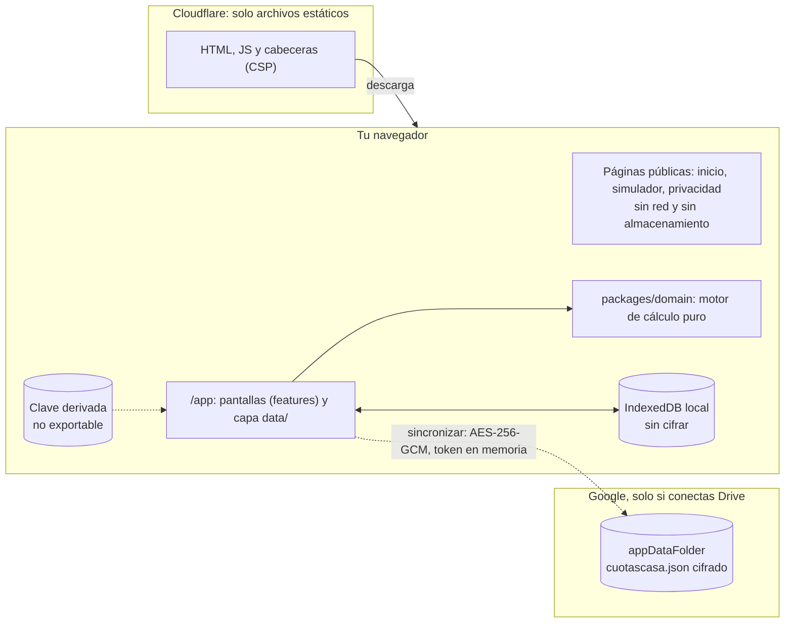
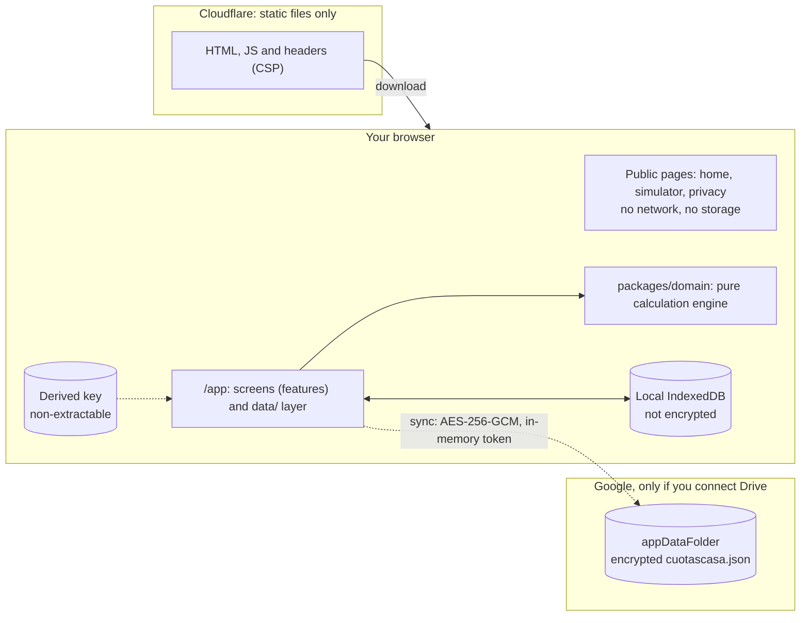

# CuotasCasa

> **En construcción · Work in progress.** Todavía no hay una versión publicada. · There is no published release yet.

Español primero, inglés después. Las dos secciones tienen la misma estructura de encabezados. · Spanish first, English after. Both sections share the same heading structure.

## Español

### Qué es

CuotasCasa es una app web _local-first_ para modelar las cuotas de préstamos de vivienda en Guatemala (fórmula FHA), proyectar abonos a capital y comparar lo proyectado con lo real. No se conecta a bancos ni mueve dinero. No tiene backend: tus datos viven en el navegador (IndexedDB) y, si lo eliges, en una copia cifrada en tu propio Google Drive.

Es un proyecto personal y de portafolio. Las decisiones están en [`docs/adr/`](docs/adr/README.md); la fórmula, en [`docs/algorithm.md`](docs/algorithm.md); los nombres ES ↔ EN, en [`docs/glossary.md`](docs/glossary.md).

### Arquitectura local-first



- **`packages/domain`:** motor de cálculo en TypeScript puro, con dinero como cadenas decimales y fechas `AAAA-MM-DD`.
- **`packages/schema`, `persistence`, `sync`, `export`:** esquemas y respaldo, repositorios (memoria y Dexie), combinación y cifrado con Google Drive, y escritores CSV, Excel y PDF.
- **`apps/web`:** Angular 22, con `public/` (sin red ni almacenamiento), `features/` y `data/` como único punto que conecta la interfaz con los paquetes.
- Las reglas de qué puede importar qué están en [`CLAUDE.md`](CLAUDE.md) y en [ADR-0010](docs/adr/0010-monorepo-pnpm-reglas-de-dependencia.md); las impone ESLint.

### Garantías de privacidad

- **Sin backend, sin cuentas, sin analítica, sin cookies.** Nadie del proyecto puede ver tus datos.
- **Las páginas públicas no hacen peticiones a otros orígenes ni guardan nada** en tu navegador.
- **Google solo se contacta si conectas Drive**, con un único alcance, `drive.appdata` (una carpeta oculta de la app). El token de acceso vive solo en memoria.
- **La copia en Drive va cifrada en tu dispositivo** (AES-256-GCM, clave derivada de tu frase con PBKDF2-SHA256 de 600 000 iteraciones). Google solo ve un archivo ilegible, su nombre, su tamaño y su fecha.
- **Límites honestos:** la base local de IndexedDB no se cifra, las exportaciones a Excel, CSV y PDF no van cifradas (la app avisa antes) y Cloudflare puede registrar datos técnicos de conexión. El detalle está en el [modelo de amenazas](docs/security/threat-model.md) y en la página `/privacidad`.
- Para reportar una vulnerabilidad, lee [`SECURITY.md`](SECURITY.md).

### Datos sintéticos y capturas

Este repositorio es público. Ningún monto, tasa, fecha, número de préstamo, documento ni dato personal real entra aquí: todos los ejemplos y fixtures son sintéticos, todo fixture JSON lleva `synthetic: true` y un hook lo exige ([ADR-0015](docs/adr/0015-higiene-repo-publico.md)).

Las capturas de pantalla, cuando se agreguen, se generarán solo con fixtures sintéticos y vivirán en `docs/screenshots/`. Hoy no hay ninguna publicada.

### Puesta en marcha

Requisitos: Node `>=24.2.0 <25` y pnpm `10.33.x` (versión fijada en `packageManager`). El oráculo de pruebas usa Python 3.13 en un entorno virtual aparte ([`tools/oracle/README.md`](tools/oracle/README.md)).

```bash
pnpm install --frozen-lockfile   # nunca `pnpm install` sin la bandera
pnpm exec ng serve               # desarrollo, con almacenamiento en memoria por defecto
pnpm build                       # build de producción + cabeceras (_headers)
```

Para ver el build con las cabeceras reales, sirve `dist/` como lo haría Cloudflare con `node tools/edge/serve.mjs` (usa `wrangler dev --local`, sin red). No hace falta ninguna cuenta para desarrollar.

### Flujo de trabajo por tarjetas

El trabajo se divide en tarjetas ([`docs/plan/cards/`](docs/plan/cards/W6-03.md)) agrupadas en olas ([`docs/plan/waves.md`](docs/plan/waves.md)). Cada tarjeta declara los archivos que posee (`owns`) y trabaja en su propio _worktree_ de git (`.worktrees/<ID>`), en una rama `card/<ID>-<slug>`. Los archivos congelados y los contratos son de la persona que coordina. Las reglas completas están en [`docs/plan/README.md`](docs/plan/README.md) y [`CLAUDE.md`](CLAUDE.md). Los commits son convencionales y los hooks nunca se saltan.

### Scripts

| Comando                                                                     | Qué hace                                                                  |
| --------------------------------------------------------------------------- | ------------------------------------------------------------------------- |
| `pnpm lint` · `pnpm typecheck`                                              | ESLint (incluye las reglas de dependencia) y TypeScript estricto          |
| `pnpm format:check`                                                         | Prettier                                                                  |
| `pnpm test`                                                                 | Vitest de los paquetes y `ng test` de la app                              |
| `pnpm test:coverage` · `pnpm test:browser`                                  | Cobertura, y pruebas de WebCrypto e IndexedDB en Chromium y WebKit        |
| `pnpm conformance`                                                          | Arnés de conformidad del motor contra los fixtures                        |
| `pnpm oracle:gen` · `pnpm oracle:diff`                                      | Genera los fixtures del oráculo y comprueba que no hay diferencia         |
| `pnpm build` · `pnpm bundle:check`                                          | Build y presupuestos de tamaño y composición de los bundles               |
| `pnpm edge:check`                                                           | Enrutamiento y cabeceras por ruta (CSP y Trusted Types)                   |
| `pnpm e2e`                                                                  | Playwright contra el build de producción servido con las cabeceras reales |
| `pnpm owns:check`                                                           | Verifica que una rama solo toca los archivos de su tarjeta                |
| `pnpm hygiene:denylist` · `pnpm hygiene:synthetic` · `pnpm hygiene:noreply` | Higiene del repositorio público                                           |

### Estrategia de pruebas

La estrategia completa está en [ADR-0014](docs/adr/0014-estrategia-de-pruebas.md). En resumen:

- **Ejemplos del algoritmo:** [`docs/specs/algorithm-examples/`](docs/specs/algorithm-examples/INDEX.md) trae un ejemplo resuelto por cada regla `[ALG.*]` de `docs/algorithm.md`, revisado por un script en CI.
- **Oráculo:** [`tools/oracle/`](tools/oracle/README.md) es una segunda implementación en Python, escrita sin mirar el motor, que genera los fixtures sintéticos. `pnpm oracle:diff` falla si lo versionado no es lo que produce el oráculo.
- **Fixtures:** todo fixture JSON lleva `synthetic: true`. Los sobres cifrados no se versionan: las pruebas los generan en ejecución.
- **Arnés de conformidad:** `tools/conformance/` compara el motor con los fixtures al centavo.
- **Suite de contrato:** los adaptadores de persistencia (memoria y Dexie) pasan la misma suite de contrato; los de sincronización usan _fakes_ compartidos de Google.
- **Propiedades y unidades:** Vitest junto al código, con fast-check para invariantes (por ejemplo, que la combinación de la sincronización sea conmutativa, idempotente y asociativa).
- **E2E:** Playwright en Chromium y WebKit sobre el build de producción, con comprobación de violaciones de CSP y sin red real (Google se simula).

### Despliegue

El sitio es un Worker de Cloudflare de solo archivos estáticos ([ADR-0002](docs/adr/0002-hosting-cloudflare-workers-subdominio.md), [ADR-0022](docs/adr/0022-cloudflare-static-routing.md)). El flujo `deploy.yml` está **dormido** hasta que el dueño configure su cuenta. Las guías, con marcadores en lugar de valores reales:

- [Despliegue en Cloudflare](docs/guides/despliegue-cloudflare.md)
- [Google Cloud: cliente OAuth y pantalla de consentimiento](docs/guides/google-cloud-setup.md)

### Licencia

[MIT](LICENSE).

## English

### What it is

CuotasCasa is a _local-first_ web app to model home-loan installments in Guatemala (FHA formula), project principal prepayments and compare the projection with what actually happened. It never connects to banks or moves money. It has no backend: your data lives in your browser (IndexedDB) and, if you choose, in an encrypted copy in your own Google Drive.

It is a personal portfolio project. Decisions live in [`docs/adr/`](docs/adr/README.md) (written in Spanish), the formula in [`docs/algorithm.md`](docs/algorithm.md), and the ES ↔ EN naming in [`docs/glossary.md`](docs/glossary.md).

### Local-first architecture



- **`packages/domain`:** pure TypeScript calculation engine, with money as decimal strings and dates as `YYYY-MM-DD`.
- **`packages/schema`, `persistence`, `sync`, `export`:** schemas and backup, repositories (memory and Dexie), merge and encryption with Google Drive, and CSV, Excel and PDF writers.
- **`apps/web`:** Angular 22, with `public/` (no network, no storage), `features/` and `data/` as the only place that connects the UI to the packages.
- The rules on what may import what are in [`CLAUDE.md`](CLAUDE.md) and [ADR-0010](docs/adr/0010-monorepo-pnpm-reglas-de-dependencia.md); ESLint enforces them.

### Privacy guarantees

- **No backend, no accounts, no analytics, no cookies.** Nobody on the project can see your data.
- **The public pages make no requests to other origins and store nothing** in your browser.
- **Google is contacted only if you connect Drive**, with a single scope, `drive.appdata` (a hidden app folder). The access token lives in memory only.
- **The Drive copy is encrypted on your device** (AES-256-GCM, key derived from your passphrase with PBKDF2-SHA256, 600,000 iterations). Google only sees an unreadable file, its name, size and date.
- **Honest limits:** the local IndexedDB is not encrypted, Excel, CSV and PDF exports are not encrypted (the app warns first) and Cloudflare may log technical connection data. Details are in the [threat model](docs/security/threat-model.md) and on the `/privacidad` page.
- To report a vulnerability, read [`SECURITY.md`](SECURITY.md).

### Synthetic data and screenshots

This repository is public. No real amount, rate, date, loan number, document or personal data goes in here: every example and fixture is synthetic, every fixture JSON carries `synthetic: true`, and a hook enforces it ([ADR-0015](docs/adr/0015-higiene-repo-publico.md)).

Screenshots, once added, will be generated from synthetic fixtures only and will live in `docs/screenshots/`. None is published today.

### Setup

Requirements: Node `>=24.2.0 <25` and pnpm `10.33.x` (pinned in `packageManager`). The test oracle uses Python 3.13 in a separate virtual environment ([`tools/oracle/README.md`](tools/oracle/README.md), in Spanish).

```bash
pnpm install --frozen-lockfile   # never plain `pnpm install`
pnpm exec ng serve               # development, in-memory storage by default
pnpm build                       # production build + headers (_headers)
```

To see the build with the real headers, serve `dist/` the way Cloudflare would with `node tools/edge/serve.mjs` (it uses `wrangler dev --local`, offline). No account is needed to develop.

### Card workflow

Work is split into cards ([`docs/plan/cards/`](docs/plan/cards/W6-03.md)) grouped in waves ([`docs/plan/waves.md`](docs/plan/waves.md)). Each card declares the files it owns (`owns`) and works in its own git worktree (`.worktrees/<ID>`), on a `card/<ID>-<slug>` branch. Frozen files and contracts belong to the coordinator. The full rules are in [`docs/plan/README.md`](docs/plan/README.md) and [`CLAUDE.md`](CLAUDE.md). Commits are conventional and hooks are never skipped.

### Scripts

| Command                                                                     | What it does                                                         |
| --------------------------------------------------------------------------- | -------------------------------------------------------------------- |
| `pnpm lint` · `pnpm typecheck`                                              | ESLint (including the dependency rules) and strict TypeScript        |
| `pnpm format:check`                                                         | Prettier                                                             |
| `pnpm test`                                                                 | Vitest for the packages and `ng test` for the app                    |
| `pnpm test:coverage` · `pnpm test:browser`                                  | Coverage, and WebCrypto and IndexedDB tests in Chromium and WebKit   |
| `pnpm conformance`                                                          | Conformance harness: the engine against the fixtures                 |
| `pnpm oracle:gen` · `pnpm oracle:diff`                                      | Generate the oracle fixtures and check there is no diff              |
| `pnpm build` · `pnpm bundle:check`                                          | Build, and bundle size and composition budgets                       |
| `pnpm edge:check`                                                           | Routing and per-route headers (CSP and Trusted Types)                |
| `pnpm e2e`                                                                  | Playwright against the production build served with the real headers |
| `pnpm owns:check`                                                           | Checks that a branch only touches its card's files                   |
| `pnpm hygiene:denylist` · `pnpm hygiene:synthetic` · `pnpm hygiene:noreply` | Public-repo hygiene                                                  |

### Testing strategy

The full strategy is in [ADR-0014](docs/adr/0014-estrategia-de-pruebas.md). In short:

- **Algorithm examples:** [`docs/specs/algorithm-examples/`](docs/specs/algorithm-examples/INDEX.md) holds one worked example for every `[ALG.*]` rule in `docs/algorithm.md`, checked by a script in CI.
- **Oracle:** [`tools/oracle/`](tools/oracle/README.md) is a second implementation in Python, written without looking at the engine, that generates the synthetic fixtures. `pnpm oracle:diff` fails if what is committed is not what the oracle produces.
- **Fixtures:** every fixture JSON carries `synthetic: true`. Encrypted envelopes are never committed: tests generate them at run time.
- **Conformance harness:** `tools/conformance/` compares the engine with the fixtures to the cent.
- **Contract suite:** the persistence adapters (memory and Dexie) pass the same contract suite; sync tests use shared Google fakes.
- **Properties and units:** Vitest next to the code, with fast-check for invariants (for example, that the sync merge is commutative, idempotent and associative).
- **E2E:** Playwright on Chromium and WebKit against the production build, checking CSP violations and with no real network (Google is mocked).

### Deploy

The site is a Cloudflare Worker serving static files only ([ADR-0002](docs/adr/0002-hosting-cloudflare-workers-subdominio.md), [ADR-0022](docs/adr/0022-cloudflare-static-routing.md)). The `deploy.yml` workflow is **dormant** until the owner configures their account. The guides, with placeholders instead of real values (in Spanish):

- [Cloudflare deployment](docs/guides/despliegue-cloudflare.md)
- [Google Cloud: OAuth client and consent screen](docs/guides/google-cloud-setup.md)

### License

[MIT](LICENSE).
