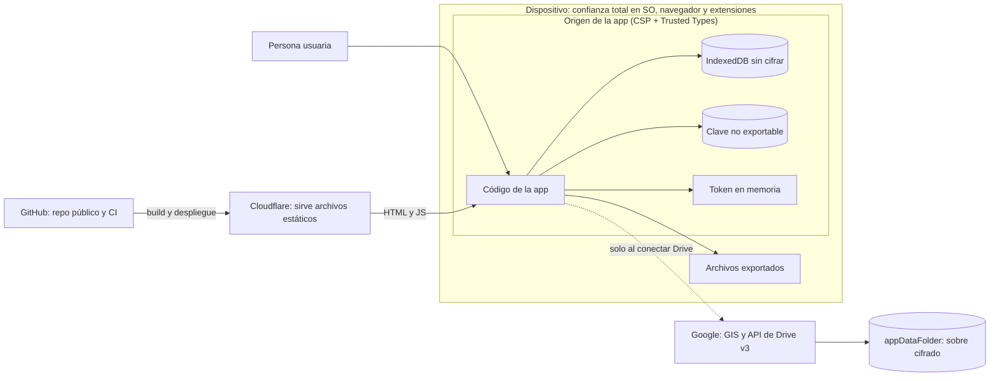
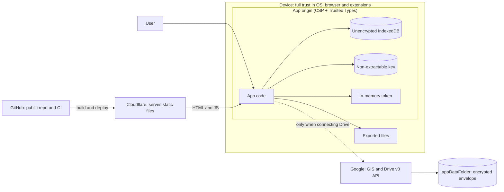

# Modelo de amenazas de CuotasCasa

Español primero, inglés después. Las dos secciones tienen la misma estructura de encabezados.

- **Alcance:** la app web (`apps/web`), sus paquetes, el sitio estático y el flujo de desarrollo del repositorio público. CuotasCasa no tiene backend (ADR-0001).
- **Estado:** escrito en W6-03 sobre el código de `main` en ese momento. Cada mitigación cita el ADR que la decide y la prueba, herramienta o archivo que la comprueba. Lo que no tiene respaldo en el código no se afirma aquí.
- **Cero datos reales.** Este documento solo describe mecanismos; no contiene montos, nombres, dominios ni identificadores reales (ADR-0015).
- Para reportar una vulnerabilidad, lee [`SECURITY.md`](../../SECURITY.md).

## Español

### Activos

| Activo | Dónde vive | Por qué importa |
| --- | --- | --- |
| Datos locales (préstamos, eventos, saldos reportados, pagos, escenarios, ajustes) | IndexedDB del navegador, **sin cifrar** (ADR-0009, decisión 9) | Son datos financieros personales. Las tablas y proyecciones no se guardan: se recalculan |
| Sobre cifrado de Drive (`cuotascasa.json` y `cuotascasa.prev.json`) | Carpeta oculta `appDataFolder` del Drive del usuario (ADR-0008) | Contiene todos los datos; solo es legible con la frase |
| Frase | La memoria de la persona y, si quiere, su gestor de contraseñas. **Nunca se guarda en la app** (ADR-0009, decisión 5) | Es el único secreto que protege la copia en Drive |
| Clave derivada | IndexedDB, como `CryptoKey` **no exportable** (`extractable: false`, usos `encrypt` y `decrypt`) | Permite sincronizar sin pedir la frase; quien ejecute código en el origen puede usarla, no extraerla |
| Token de acceso de Drive | Solo la memoria de la pestaña, unos 60 minutos (ADR-0008, decisión 3) | Da acceso a la carpeta oculta de la app y a ninguna otra cosa (`drive.appdata`) |
| Archivos exportados (Excel, CSV, PDF y respaldo JSON) | El disco de la persona | Excel, CSV y PDF van sin cifrar; el respaldo JSON puede ir cifrado (ADR-0007, ADR-0013) |
| Integridad del sitio publicado | Cloudflare y la canalización de GitHub | Quien controle el código servido controla todo lo anterior mientras la página esté abierta |
| Repositorio público | GitHub | No debe contener datos reales ni secretos (ADR-0015) |

### Fronteras de confianza

Se confía en: el sistema operativo y el navegador de la persona (incluidas las extensiones con permiso sobre el sitio), el código que Cloudflare sirve tal como se compiló, y a Google solo para disponibilidad (no para confidencialidad: ve texto cifrado). No se confía en: el contenido de un archivo de Drive o de un respaldo importado (se valida antes de usarlo), ni en el script de Google más allá de lo que la CSP le permite.

Las páginas públicas (`/`, `/privacidad` y la 404) no tienen ningún origen externo en su CSP, así que están **fuera** de la frontera de Google: no pueden contactarlo aunque tuvieran una vulnerabilidad (ADR-0016, ADR-0021).

### Modelos de atacante

| Atacante | Qué puede hacer | Qué mitiga | Qué queda |
| --- | --- | --- | --- |
| Dispositivo perdido, robado o desbloqueado | Abrir el navegador y la app, leer IndexedDB y usar la clave guardada | Cifrado de disco del sistema y bloqueo de sesión (responsabilidad de la persona); el token de Drive vence en ~1 h y no se guarda | La app **no tiene bloqueo propio** y IndexedDB no está cifrada: ver riesgos residuales |
| Cuenta de Google comprometida | Ver, borrar o reemplazar `cuotascasa.json`; ver su nombre, tamaño y fecha | La copia va cifrada con AES-256-GCM; alterarla se detecta al descifrar | Puede borrarla o dejarla ilegible (disponibilidad); no se detecta que reponga una copia anterior válida |
| Red (intermediario, DNS) | Observar o alterar el tráfico | HTTPS y HSTS; la CSP limita `connect-src`; la copia viaja cifrada | Confianza en la cadena TLS y en el DNS del dominio |
| XSS o dependencia comprometida | Ejecutar código en el origen: leer IndexedDB, **usar** la clave no exportable, usar el token mientras viva | CSP estricta por ruta, Trusted Types aplicado, sin `bypassSecurityTrust*`, `connect-src` acotado, lockfile y auditoría | Un XSS que logre ejecutarse puede usar la clave y el token: ver riesgos residuales |
| Cadena de suministro (npm, acciones de CI, hosting) | Introducir código malicioso al compilar o desplegar | Versiones exactas, antigüedad mínima de 7 días, scripts de instalación bloqueados, acciones fijadas por SHA, `pnpm audit` | Una dependencia comprometida antes de que se detecte; confianza en Cloudflare y en GitHub |
| Archivo de respaldo o de Drive malicioso | Un JSON mal formado, ajeno, de versión futura o con parámetros de cifrado hostiles | `parseBackup` nunca lanza y valida con zod; importación por etapas con vista previa y deshacer; topes de iteraciones | Un respaldo sin cifrar **no está autenticado**: ver riesgos residuales |
| Filtración por el repositorio público | Datos reales o secretos en el código, el historial, un PR o una captura | `.gitignore` defensivo, gitleaks (pre-commit y CI sobre el historial completo), marca `synthetic: true`, correo noreply, lista local de términos | La lista local es opcional; texto pegado en un PR o issue no lo ve ningún hook |

### Mitigaciones

Cada fila indica dónde se decide y qué la comprueba. «Prueba» es una prueba automática (unidad, navegador, e2e o de compilación) o un chequeo de CI; «herramienta» es un script del repositorio.

#### En el navegador

| Mitigación | Decisión | Comprobación |
| --- | --- | --- |
| CSP estricta por ruta: sin `'unsafe-inline'` ni `'unsafe-eval'` en `script-src`; hashes de los scripts inline calculados después del build y escritos solo en `_headers`; las rutas públicas sin ningún origen externo; `frame-ancestors 'none'` | ADR-0016, ADR-0021 | Herramienta `tools/edge/headers/` (`pnpm edge:check` y `smoke-csp.mjs`, en CI); `apps/web/src/testing/build-output/`; `collectCspViolations` en los e2e (`e2e/support/expectations.ts`) |
| Trusted Types **aplicado** (`require-trusted-types-for 'script'`) en todas las rutas. Políticas permitidas: `angular` y `angular#bundler`; en `/app/*` además `cc-gis-loader` y `cc-sw-loader`. Nunca `default`, `angular#unsafe-bypass` ni `'allow-duplicates'` | ADR-0021, decisión 2 | `edge:check` afirma las cabeceras literalmente; el smoke de Chromium y los e2e de Chromium y WebKit no deben registrar violaciones |
| Sin sumideros del DOM propios: la app no usa `innerHTML` ni `bypassSecurityTrust*`. Lo segundo lo prohíbe ESLint; lo primero lo bloquea Trusted Types en ejecución | ADR-0016, ADR-0021 | Regla `no-restricted-syntax` de `eslint.config.mjs` (`pnpm lint`); una búsqueda en `apps/web/src` no encuentra `innerHTML` fuera de comentarios y pruebas; `packages/export/src/pdf/pdf.spec.ts` vigila que el código de PDF no use sumideros de HTML |
| GIS se carga solo al conectar Drive, con una política de Trusted Types cuyo `createScriptURL` acepta solo `https://accounts.google.com/gsi/client` | ADR-0021, decisión 3 | `packages/sync/src/google-drive/gis-loader.spec.ts`; e2e de Ajustes con Google simulado |
| `connect-src` de `/app/*` limitado a tres rutas de Google (`drive/v3/`, `upload/drive/v3/` y `oauth2.googleapis.com/revoke`), y `frame-src 'none'` | ADR-0021, decisión 4 | `edge:check` afirma la cabecera literal; la evidencia de W2-02 (ADR-0021) midió el bloqueo de una ruta de otra API de Google en Chromium y WebKit |
| Alcance `drive.appdata` y ningún otro; carpeta `appDataFolder` | ADR-0008, decisión 2 | `DRIVE_APPDATA_SCOPE` en `packages/sync/src/ports.ts`; pruebas del proveedor y del _fake_ de Drive, que rechaza cualquier llamada fuera del subconjunto ([`docs/specs/drive-api-subset.md`](../specs/drive-api-subset.md)) |
| Token solo en memoria (una variable de cierre, nunca `localStorage`, `sessionStorage`, IndexedDB ni cookies); «Desconectar Drive» lo revoca | ADR-0008, decisión 3 | `packages/sync/src/google-drive/provider.ts` y sus pruebas; e2e de Ajustes |
| Landing y `/privacidad` sin red ni almacenamiento | ADR-0016, ADR-0011 | `expectNoExternalRequests` y `expectNoClientStorage` en los e2e públicos |
| Cero código de Google, de sincronización, de persistencia o de exportación en el bundle de la landing; en el bundle inicial de `/app`, sin código de Google Drive ni el cifrado (`sync/crypto`) | ADR-0016, ADR-0025 | `pnpm bundle:check` (`tools/bundle-check/config.json`, lista `forbidden`) |
| Sin cookies, analítica, telemetría ni fuentes externas | ADR-0016 | Los e2e públicos; la política de `/privacidad` lo declara |

#### Cifrado

| Mitigación | Decisión | Comprobación |
| --- | --- | --- |
| AES-256-GCM con IV aleatorio de 96 bits por cifrado, y clave derivada con PBKDF2-SHA256 de **600 000** iteraciones. Solo WebCrypto, sin librerías criptográficas de terceros | ADR-0009, decisión 1 | `packages/sync/src/crypto/` (`crypto.spec.ts` y `crypto.browser.spec.ts` en Chromium y WebKit), incluida una prueba de 10 000 IV distintos |
| Sobre versionado con la cabecera completa como datos autenticados (AAD): alterar cualquier parámetro, sal, IV o texto cifrado invalida el descifrado | ADR-0009, decisión 2 y adenda | `crypto.spec.ts` |
| Topes de iteraciones: se rechaza antes de descifrar un sobre con menos de 600 000 (no se puede degradar el KDF) o con más de 10 000 000 (un archivo hostil no cuelga la pestaña), y la sal tiene un tamaño acotado | ADR-0009, adenda; ADR-0007, enmienda de W4 | `packages/sync/src/crypto/envelope.ts` (`MAX_PBKDF2_ITERATIONS`) y sus pruebas |
| Clave del dispositivo no exportable: `extractable: false`, AES-GCM de 256 bits y usos exactos; el almacén rechaza cualquier otra forma. La frase no se guarda | ADR-0009, decisión 5 | `packages/sync/src/crypto/key-store.ts` y `key-store.spec.ts`; el KeyStore se prueba en Chromium y WebKit |
| La frase se normaliza a NFC antes de derivar, para que dos dispositivos obtengan la misma clave | ADR-0009, adenda | `crypto.spec.ts` |
| Errores tipados sin texto en claro (`WrongPassphraseOrTamper`, `UnsupportedVersion`, `WeakParams`, `KeyMismatch`) | ADR-0009, decisión 4 | `crypto.spec.ts` |
| Nunca se sube texto en claro a Drive; la clave nueva se guarda solo después de una subida exitosa al cambiar la frase | ADR-0008, decisión 4 y enmienda de W4 | Pruebas de `SyncSession` y del servicio de sincronización |
| Ningún sobre cifrado queda versionado en el repositorio | ADR-0009, decisión 2 | `packages/sync/src/crypto/repo-scan.spec.ts` recorre los archivos que git rastrea |

#### Datos importados y combinación

| Mitigación | Decisión | Comprobación |
| --- | --- | --- |
| `parseBackup` nunca lanza: JSON inválido, formato ajeno, versión futura o validación fallida dan un error tipado y no tocan el almacenamiento | ADR-0007, decisión 3 | Pruebas del códec de `packages/schema` |
| Importación por etapas: vista previa con conteos, confirmación, instantánea, `replaceAll` en una transacción y «Deshacer» durante 10 minutos como máximo; ante una escritura ajena, la instantánea se descarta | ADR-0007, decisión 5 y enmiendas | Pruebas del servicio de respaldo (`apps/web/src/app/data/backup/`) y e2e de Ajustes |
| Un archivo de Drive ilegible o de versión futura detiene la sesión sin guardar ni subir nada | ADR-0008, decisión 4 | Pruebas de `SyncSession` |
| Copia previa `cuotascasa.prev.json` antes de cada subida, y relectura del estado remoto justo antes de subir | ADR-0008, decisiones 4 y 5 | Pruebas de `SyncSession` |
| Una sincronización a la vez, también entre pestañas (Web Locks, candado `cuotascasa-sync`) | ADR-0008, decisión 5 | Pruebas de `SyncSession` |
| Combinación con orden total determinista: conmutativa, idempotente y asociativa | ADR-0024 | Propiedades con fast-check (≥ 500 corridas cada una) en `packages/sync` |
| Los ajustes del dispositivo nunca se suben ni se importan | ADR-0024, decisión 4; ADR-0007, decisión 6 | Pruebas de la combinación y de la suite de contrato de persistencia |
| Exportaciones sin cifrar: aviso antes de la primera descarga de cada sesión y opción de respaldo cifrado con la misma frase de Drive | ADR-0007 (enmiendas), ADR-0013 | `export-menu.component.spec.ts`, `settings-backup.component.spec.ts` y `e2e/specs/settings-backup.spec.ts` |

#### Cadena de suministro y repositorio público

| Mitigación | Decisión | Comprobación |
| --- | --- | --- |
| Dependencias fijadas en el catálogo de pnpm con versiones exactas (`save-exact`), instalación con `--frozen-lockfile`, y sin dependencias nuevas sin aprobación | ADR-0010, ADR-0016 | `pnpm catalog:check` en CI |
| Scripts de instalación bloqueados (`strict-dep-builds`); solo `lefthook` puede ejecutar uno | ADR-0016 | `.npmrc` y `pnpm-workspace.yaml` |
| Renovate con antigüedad mínima de 7 días, versiones fijadas, actualizaciones mayores con aprobación manual y acciones de GitHub fijadas por SHA | ADR-0016, ADR-0015 | `renovate.json` y `tools/hygiene/renovate.spec.ts` |
| Acciones de GitHub fijadas por SHA completo; gitleaks se descarga fijado y con suma de verificación; permisos de solo lectura | ADR-0015 | `.github/workflows/ci.yml` y `deploy.yml` |
| `pnpm audit --prod --audit-level high` como paso de CI | ADR-0016 | `.github/workflows/ci.yml` |
| El despliegue exige que un CI de `main` haya pasado y la aprobación de un revisor del entorno `production`; el token de Cloudflare se limita a una cuenta y una zona | ADR-0002, ADR-0015 | `.github/workflows/deploy.yml`; [guía de despliegue](../guides/despliegue-cloudflare.md) (la aprobación y el alcance del token los configura el dueño) |
| `.gitignore` defensivo para los formatos en que llegan los datos reales (hojas de cálculo, PDF, correos, capturas, respaldos de la app, `.env`) | ADR-0015, decisión 3 | `tools/hygiene/gitignore.spec.ts` |
| gitleaks en pre-commit y en CI sobre el historial completo, con una regla propia para el ID de cliente de Google | ADR-0015, decisión 5 | `lefthook.yml`, `.gitleaks.toml`, trabajo `secrets` de CI |
| Lista local de términos prohibidos (opcional, fuera del repositorio), comparación por palabra y número completos; informa solo archivo y línea | ADR-0015, decisión 6 | `tools/hygiene/denylist.mjs` y `denylist.spec.ts` |
| Todo fixture JSON lleva `synthetic: true`; un fixture ignorado por git falla | ADR-0015, decisión 2 | `tools/hygiene/synthetic-flag.mjs` y su prueba, en el hook de pre-commit |
| Correo de autoría `noreply` | ADR-0015, decisión 7 | `tools/hygiene/noreply.mjs` |
| El ID de cliente de Google y el token de Cloudflare no están en el código: el primero se inyecta al compilar y el segundo vive en los secretos de GitHub | ADR-0015, decisión 9 | `apps/web/src/environments/build-constants.dist.spec.ts`; regla de gitleaks |

### Riesgos residuales

Se aceptan o se documentan; ninguno está resuelto por el código.

1. **IndexedDB local no está cifrada.** Quien tenga acceso al perfil del navegador (dispositivo robado y desbloqueado, otra persona con la misma sesión del sistema, malware) lee los datos. La app no tiene bloqueo propio. La defensa es el cifrado de disco y el bloqueo de sesión (ADR-0009, decisión 9). Cifrarla no protegería contra un XSS, porque la app necesita la clave en el mismo origen.
2. **Dispositivo compartido.** En una sesión de sistema compartida, cualquiera que abra el navegador ve los datos y puede sincronizar con la clave guardada. Quien use un equipo compartido no debería guardar ahí la clave ni los datos.
3. **XSS o dependencia comprometida en ejecución.** Código que corra en el origen puede leer IndexedDB, **usar** (no extraer) la clave y llamar a Drive mientras el token esté vigente (ADR-0009, ADR-0016). La CSP y Trusted Types reducen la probabilidad, no la eliminan. Además `style-src` admite `'unsafe-inline'` (ADR-0021, decisión 5), lo que deja abierta la inyección de CSS; se acepta porque Angular sanea el HTML y la app no inserta HTML de la persona.
4. **El script de GIS es código de un tercero** y no lleva integridad de subrecurso, porque Google no publica versiones fijas (ADR-0016). Se limita con carga diferida, CSP, una política de Trusted Types propia y el alcance mínimo.
5. **Confianza en Cloudflare y en la canalización.** Quien controle la cuenta de Cloudflare, la cuenta de GitHub o la canalización de despliegue puede servir código malicioso; no hay compilaciones reproducibles ni verificación del lado del cliente. Cloudflare, además, puede **registrar datos técnicos de acceso**, como la dirección IP; CuotasCasa no activa su analítica ni lee esos registros (`/privacidad`, ADR-0016 enmienda de W4).
6. **Frase débil o perdida.** PBKDF2 no resiste en memoria: si se filtra el archivo, una frase corta cae por fuerza bruta. La interfaz mide la frase y recomienda 12 caracteres o más, pero **es una guía, no una compuerta** (`apps/web/src/app/features/settings/sync/passphrase-strength.ts`). Si la persona olvida la frase **y** pierde todos los dispositivos con la clave, la copia de Drive es irrecuperable (ADR-0009, decisión 7); cualquier dispositivo con la clave puede definir una frase nueva.
7. **Reversión silenciosa de la copia en Drive.** GCM detecta la alteración de un sobre, pero no que se sustituya por otro sobre anterior válido con la misma clave. La combinación por registro conserva lo local más nuevo, por lo que el efecto sobre un dispositivo con datos es limitado; un dispositivo nuevo recibiría la versión vieja.
8. **Sin escritura condicional en Drive.** Dos subidas simultáneas pueden pisarse. Mitigan la relectura previa y `cuotascasa.prev.json`, pero queda una ventana (ADR-0008, ADR-0024).
9. **Last-writer-wins pierde ediciones simultáneas.** Si el mismo registro se edita en dos dispositivos antes de sincronizar, solo sobrevive la edición más reciente. Un escenario es **un solo registro**: dos ediciones simultáneas del mismo escenario no se mezclan evento por evento, gana el arreglo completo de la versión ganadora (ADR-0024, enmienda de W5).
10. **Desfase de reloj.** Un dispositivo con el reloj adelantado gana los conflictos mientras dure el adelanto; el sellado monótono evita que un reloj que retrocede genere estampas menores, y la siguiente edición del otro dispositivo sobre ese registro vuelve a ganar. No se corrige el reloj del sistema (ADR-0024). Un reloj adelantado también acorta la purga de 90 días, porque `lastSyncAt` sale del reloj local.
11. **Resurrección tras la purga.** Un dispositivo sin sincronizar durante más de 90 días puede revivir registros cuya marca de borrado ya se purgó; lo mismo ocurre con una marca antigua importada de un respaldo que nunca se subió (ADR-0008, decisión 4; ADR-0024).
12. **Escrituras locales durante una sincronización.** `LocalDataset.save` reemplaza todo el conjunto local: una escritura entre la lectura y el guardado se pierde, y `markSynced` pone los cambios pendientes en 0 aunque haya ediciones concurrentes (ADR-0024; hallazgos de W2 y W4 en `docs/plan/implementation/w0/README.md`). Se acepta la ventana.
13. **«Deshacer» una importación tiene un TOCTOU.** Antes de restaurar se compara una huella del estado, pero entre esa comprobación y `restoreSnapshot` una escritura puede perderse. Lo cerraría una restauración atómica y condicional en el puerto de persistencia, pendiente como micro-tarjeta (ADR-0007, enmienda de W4; `apps/web/src/app/data/backup/provide-backup.ts`).
14. **Un respaldo sin cifrar no está autenticado.** `parseBackup` valida la forma, no el origen: un archivo fabricado con cifras plausibles se importa si la persona confirma (la vista previa muestra conteos, no importes). Como la importación conserva los sellos de cada registro (ADR-0007), un respaldo con `updatedAt` futuros ganaría después la combinación contra Drive. Un respaldo cifrado sí se autentica con la frase.
15. **Exportaciones sin cifrar.** Los archivos Excel, CSV y PDF, y el respaldo JSON sin cifrar, dejan datos financieros en claro en el disco. La app avisa antes de la primera descarga de cada sesión (ADR-0007, ADR-0013); lo que la persona haga con el archivo queda fuera del alcance.
16. **Safari (ITP) y desalojo del almacenamiento.** Safari borra el almacenamiento de un sitio tras 7 días de uso de Safari sin visitarlo, y Chrome o Edge pueden desalojarlo bajo presión de espacio. No se puede impedir: la app avisa en Safari, pide almacenamiento persistente en el primer guardado y recuerda respaldar (más de 30 días o más de 20 cambios). La exención de las apps instaladas no está verificada (ADR-0017).
17. **Extensiones del navegador y sistema operativo comprometidos.** Una extensión con permiso sobre el sitio o un sistema comprometido están fuera de lo que la app puede defender (ADR-0016).
18. **La lista local de términos prohibidos es opcional**, depende de que el dueño la mantenga, y los hooks no ven texto pegado en un PR o issue. Si algo real llega a GitHub, se considera expuesto: se limpia el historial y se rota lo que corresponda (ADR-0015, decisiones 6 y 12).
19. **Origen de Google sin verificar en vivo.** La coincidencia por ruta del `connect-src` se probó con Google simulado, no contra Google real; la verificación con Drive real es un paso manual previo a la versión 1.0 (ADR-0021, riesgos; ADR-0008, verificación).

### Referencias

- [ADR-0007](../adr/0007-formato-de-respaldo-json.md), [ADR-0008](../adr/0008-sincronizacion-google-drive.md), [ADR-0009](../adr/0009-cifrado-con-frase.md), [ADR-0013](../adr/0013-exportacion-en-el-cliente.md), [ADR-0015](../adr/0015-higiene-repo-publico.md), [ADR-0016](../adr/0016-seguridad-en-el-cliente.md), [ADR-0017](../adr/0017-pwa-y-durabilidad.md), [ADR-0021](../adr/0021-csp-trusted-types-gis.md), [ADR-0022](../adr/0022-cloudflare-static-routing.md), [ADR-0024](../adr/0024-sync-merge-order.md), [ADR-0025](../adr/0025-presupuestos-de-bundle.md).
- [Subconjunto de la API de Drive](../specs/drive-api-subset.md), [guía de despliegue](../guides/despliegue-cloudflare.md) y [guía de Google Cloud](../guides/google-cloud-setup.md).
- [Política de seguridad](../../SECURITY.md).

## English

### Assets

| Asset | Where it lives | Why it matters |
| --- | --- | --- |
| Local data (loans, events, reported balances, payments, scenarios, settings) | Browser IndexedDB, **not encrypted** (ADR-0009, decision 9) | Personal financial data. Tables and projections are not stored: they are recomputed |
| Encrypted Drive envelope (`cuotascasa.json` and `cuotascasa.prev.json`) | The hidden `appDataFolder` in the user's Drive (ADR-0008) | Holds all the data; readable only with the passphrase |
| Passphrase | The person's memory and, optionally, their password manager. **Never stored by the app** (ADR-0009, decision 5) | The only secret protecting the Drive copy |
| Derived key | IndexedDB, as a **non-extractable** `CryptoKey` (`extractable: false`, usages `encrypt` and `decrypt`) | Lets sync run without asking for the passphrase; code running in the origin can use it, not extract it |
| Drive access token | Tab memory only, about 60 minutes (ADR-0008, decision 3) | Grants access to the app's hidden folder and nothing else (`drive.appdata`) |
| Exported files (Excel, CSV, PDF and JSON backup) | The person's disk | Excel, CSV and PDF are unencrypted; the JSON backup can be encrypted (ADR-0007, ADR-0013) |
| Integrity of the published site | Cloudflare and the GitHub pipeline | Whoever controls the served code controls everything above while the page is open |
| Public repository | GitHub | Must hold no real data and no secrets (ADR-0015) |

### Trust boundaries

Trusted: the person's operating system and browser (including extensions with access to the site), the code Cloudflare serves exactly as built, and Google only for availability (not confidentiality: it sees ciphertext). Not trusted: the content of a Drive file or an imported backup (validated before use), and Google's script beyond what the CSP allows it.

The public pages (`/`, `/privacidad` and the 404) have no external origin in their CSP, so they sit **outside** the Google boundary: they cannot contact it even if they had a vulnerability (ADR-0016, ADR-0021).

### Attacker models

| Attacker | What they can do | What mitigates it | What remains |
| --- | --- | --- | --- |
| Lost, stolen or unlocked device | Open the browser and the app, read IndexedDB and use the stored key | System disk encryption and session lock (the person's responsibility); the Drive token expires in ~1 h and is not stored | The app has **no lock of its own** and IndexedDB is not encrypted: see residual risks |
| Compromised Google account | See, delete or replace `cuotascasa.json`; see its name, size and date | The copy is encrypted with AES-256-GCM; tampering is detected on decryption | They can delete it or make it unreadable (availability); restoring an older valid copy is not detected |
| Network (man in the middle, DNS) | Observe or alter traffic | HTTPS and HSTS; the CSP limits `connect-src`; the copy travels encrypted | Trust in the TLS chain and the domain's DNS |
| XSS or compromised dependency | Run code in the origin: read IndexedDB, **use** the non-extractable key, use the token while it lives | Strict per-route CSP, enforced Trusted Types, no `bypassSecurityTrust*`, narrow `connect-src`, lockfile and audit | An XSS that manages to run can use the key and the token: see residual risks |
| Supply chain (npm, CI actions, hosting) | Introduce malicious code at build or deploy time | Exact versions, 7-day minimum age, install scripts blocked, actions pinned by SHA, `pnpm audit` | A dependency compromised before it is detected; trust in Cloudflare and GitHub |
| Malicious backup or Drive file | Malformed, foreign, future-version JSON or hostile encryption parameters | `parseBackup` never throws and validates with zod; staged import with preview and undo; iteration caps | An unencrypted backup is **not authenticated**: see residual risks |
| Public repository leak | Real data or secrets in code, history, a PR or a screenshot | Defensive `.gitignore`, gitleaks (pre-commit and CI over the full history), `synthetic: true` marker, noreply email, local term list | The local list is optional; text pasted into a PR or issue is not seen by any hook |

### Mitigations

Each row says where it is decided and what checks it. "Test" means an automated test (unit, browser, e2e or build) or a CI check; "tool" is a script in the repository.

#### In the browser

| Mitigation | Decision | Verification |
| --- | --- | --- |
| Strict per-route CSP: no `'unsafe-inline'` or `'unsafe-eval'` in `script-src`; hashes of inline scripts computed after the build and written only to `_headers`; public routes with no external origin; `frame-ancestors 'none'` | ADR-0016, ADR-0021 | Tool `tools/edge/headers/` (`pnpm edge:check` and `smoke-csp.mjs`, in CI); `apps/web/src/testing/build-output/`; `collectCspViolations` in the e2e tests (`e2e/support/expectations.ts`) |
| Trusted Types **enforced** (`require-trusted-types-for 'script'`) on every route. Allowed policies: `angular` and `angular#bundler`; on `/app/*` also `cc-gis-loader` and `cc-sw-loader`. Never `default`, `angular#unsafe-bypass` or `'allow-duplicates'` | ADR-0021, decision 2 | `edge:check` asserts the headers literally; the Chromium smoke test and the Chromium and WebKit e2e tests must record no violations |
| No DOM sinks of our own: the app uses neither `innerHTML` nor `bypassSecurityTrust*`. ESLint forbids the latter; Trusted Types blocks the former at run time | ADR-0016, ADR-0021 | `no-restricted-syntax` rule in `eslint.config.mjs` (`pnpm lint`); a search of `apps/web/src` finds no `innerHTML` outside comments and tests; `packages/export/src/pdf/pdf.spec.ts` guards that the PDF code uses no HTML sinks |
| GIS loads only when connecting Drive, through a Trusted Types policy whose `createScriptURL` accepts only `https://accounts.google.com/gsi/client` | ADR-0021, decision 3 | `packages/sync/src/google-drive/gis-loader.spec.ts`; Settings e2e with mocked Google |
| `connect-src` on `/app/*` limited to three Google paths (`drive/v3/`, `upload/drive/v3/` and `oauth2.googleapis.com/revoke`), and `frame-src 'none'` | ADR-0021, decision 4 | `edge:check` asserts the header literally; the W2-02 evidence (ADR-0021) measured the blocking of another Google API path on Chromium and WebKit |
| `drive.appdata` scope and no other; `appDataFolder` | ADR-0008, decision 2 | `DRIVE_APPDATA_SCOPE` in `packages/sync/src/ports.ts`; provider tests and the Drive fake, which rejects any call outside the subset ([`docs/specs/drive-api-subset.md`](../specs/drive-api-subset.md)) |
| Token in memory only (a closure variable, never `localStorage`, `sessionStorage`, IndexedDB or cookies); "Desconectar Drive" revokes it | ADR-0008, decision 3 | `packages/sync/src/google-drive/provider.ts` and its tests; Settings e2e |
| Landing and `/privacidad` with no network and no storage | ADR-0016, ADR-0011 | `expectNoExternalRequests` and `expectNoClientStorage` in the public e2e tests |
| No Google, sync, persistence or export code in the landing bundle; in the initial `/app` bundle, no Google Drive code and no encryption (`sync/crypto`) | ADR-0016, ADR-0025 | `pnpm bundle:check` (`tools/bundle-check/config.json`, `forbidden` list) |
| No cookies, analytics, telemetry or external fonts | ADR-0016 | The public e2e tests; the `/privacidad` policy states it |

#### Encryption

| Mitigation | Decision | Verification |
| --- | --- | --- |
| AES-256-GCM with a random 96-bit IV per encryption, and a key derived with PBKDF2-SHA256 at **600,000** iterations. WebCrypto only, no third-party crypto libraries | ADR-0009, decision 1 | `packages/sync/src/crypto/` (`crypto.spec.ts` and `crypto.browser.spec.ts` on Chromium and WebKit), including a test of 10,000 distinct IVs |
| Versioned envelope with the whole header as additional authenticated data (AAD): altering any parameter, salt, IV or ciphertext invalidates decryption | ADR-0009, decision 2 and addendum | `crypto.spec.ts` |
| Iteration caps: an envelope with fewer than 600,000 (the KDF cannot be downgraded) or more than 10,000,000 (a hostile file cannot hang the tab) is rejected before decrypting, and the salt has a bounded size | ADR-0009, addendum; ADR-0007, W4 amendment | `packages/sync/src/crypto/envelope.ts` (`MAX_PBKDF2_ITERATIONS`) and its tests |
| Non-extractable device key: `extractable: false`, 256-bit AES-GCM and exact usages; the store rejects any other shape. The passphrase is not stored | ADR-0009, decision 5 | `packages/sync/src/crypto/key-store.ts` and `key-store.spec.ts`; the KeyStore is tested on Chromium and WebKit |
| The passphrase is NFC-normalized before derivation so two devices get the same key | ADR-0009, addendum | `crypto.spec.ts` |
| Typed errors with no plaintext (`WrongPassphraseOrTamper`, `UnsupportedVersion`, `WeakParams`, `KeyMismatch`) | ADR-0009, decision 4 | `crypto.spec.ts` |
| Plaintext is never uploaded to Drive; the new key is stored only after a successful upload when the passphrase changes | ADR-0008, decision 4 and W4 amendment | `SyncSession` and sync service tests |
| No encrypted envelope is ever committed to the repository | ADR-0009, decision 2 | `packages/sync/src/crypto/repo-scan.spec.ts` walks the files git tracks |

#### Imported data and merge

| Mitigation | Decision | Verification |
| --- | --- | --- |
| `parseBackup` never throws: invalid JSON, a foreign format, a future version or failed validation give a typed error and do not touch storage | ADR-0007, decision 3 | `packages/schema` codec tests |
| Staged import: preview with counts, confirmation, snapshot, `replaceAll` in one transaction and "Deshacer" for at most 10 minutes; on a foreign write the snapshot is dropped | ADR-0007, decision 5 and amendments | Backup service tests (`apps/web/src/app/data/backup/`) and Settings e2e |
| An unreadable or future-version Drive file stops the session without saving or uploading anything | ADR-0008, decision 4 | `SyncSession` tests |
| Previous copy `cuotascasa.prev.json` before every upload, and a re-read of the remote state right before uploading | ADR-0008, decisions 4 and 5 | `SyncSession` tests |
| One sync at a time, across tabs too (Web Locks, lock `cuotascasa-sync`) | ADR-0008, decision 5 | `SyncSession` tests |
| Deterministic total merge order: commutative, idempotent and associative | ADR-0024 | fast-check properties (≥ 500 runs each) in `packages/sync` |
| Device settings are never uploaded or imported | ADR-0024, decision 4; ADR-0007, decision 6 | Merge tests and the persistence contract suite |
| Unencrypted exports: a warning before the first download of each session and an encrypted-backup option using the same Drive passphrase | ADR-0007 (amendments), ADR-0013 | `export-menu.component.spec.ts`, `settings-backup.component.spec.ts` and `e2e/specs/settings-backup.spec.ts` |

#### Supply chain and public repository

| Mitigation | Decision | Verification |
| --- | --- | --- |
| Dependencies pinned in the pnpm catalog with exact versions (`save-exact`), installs with `--frozen-lockfile`, and no new dependencies without approval | ADR-0010, ADR-0016 | `pnpm catalog:check` in CI |
| Install scripts blocked (`strict-dep-builds`); only `lefthook` may run one | ADR-0016 | `.npmrc` and `pnpm-workspace.yaml` |
| Renovate with a 7-day minimum age, pinned versions, majors only with manual approval, and GitHub Actions pinned by SHA | ADR-0016, ADR-0015 | `renovate.json` and `tools/hygiene/renovate.spec.ts` |
| GitHub Actions pinned by full SHA; gitleaks downloaded pinned and checksum-verified; read-only permissions | ADR-0015 | `.github/workflows/ci.yml` and `deploy.yml` |
| `pnpm audit --prod --audit-level high` as a CI step | ADR-0016 | `.github/workflows/ci.yml` |
| Deploy requires a passing CI run on `main` and approval by a `production` environment reviewer; the Cloudflare token is limited to one account and one zone | ADR-0002, ADR-0015 | `.github/workflows/deploy.yml`; [deployment guide](../guides/despliegue-cloudflare.md) (the approval and the token scope are configured by the owner) |
| Defensive `.gitignore` for the formats real data arrives in (spreadsheets, PDFs, emails, screenshots, app backups, `.env`) | ADR-0015, decision 3 | `tools/hygiene/gitignore.spec.ts` |
| gitleaks on pre-commit and in CI over the full history, with a project rule for the Google client ID | ADR-0015, decision 5 | `lefthook.yml`, `.gitleaks.toml`, the CI `secrets` job |
| Optional local list of forbidden terms (outside the repository), whole-word and whole-number matching; reports only file and line | ADR-0015, decision 6 | `tools/hygiene/denylist.mjs` and `denylist.spec.ts` |
| Every fixture JSON carries `synthetic: true`; a git-ignored fixture fails | ADR-0015, decision 2 | `tools/hygiene/synthetic-flag.mjs` and its test, in the pre-commit hook |
| `noreply` authoring email | ADR-0015, decision 7 | `tools/hygiene/noreply.mjs` |
| The Google client ID and the Cloudflare token are not in the code: the first is injected at build time and the second lives in GitHub secrets | ADR-0015, decision 9 | `apps/web/src/environments/build-constants.dist.spec.ts`; gitleaks rule |

### Residual risks

They are accepted or documented; none is solved by the code.

1. **Local IndexedDB is not encrypted.** Anyone with access to the browser profile (a stolen unlocked device, another person on the same system session, malware) reads the data. The app has no lock of its own. The defence is disk encryption and session lock (ADR-0009, decision 9). Encrypting it would not protect against XSS, because the app needs the key in the same origin.
2. **Shared device.** On a shared system session, anyone who opens the browser sees the data and can sync with the stored key. Someone using a shared machine should not keep the key or the data there.
3. **XSS or a compromised dependency at run time.** Code running in the origin can read IndexedDB, **use** (not extract) the key and call Drive while the token is valid (ADR-0009, ADR-0016). CSP and Trusted Types reduce the likelihood, not remove it. Also `style-src` allows `'unsafe-inline'` (ADR-0021, decision 5), which leaves CSS injection open; it is accepted because Angular sanitizes HTML and the app inserts none from the person.
4. **The GIS script is third-party code** with no subresource integrity, because Google does not publish pinned versions (ADR-0016). It is bounded by deferred loading, the CSP, its own Trusted Types policy and the minimal scope.
5. **Trust in Cloudflare and in the pipeline.** Whoever controls the Cloudflare account, the GitHub account or the deploy pipeline can serve malicious code; there are no reproducible builds or client-side verification. Cloudflare may also **log technical access data**, such as the IP address; CuotasCasa does not enable its analytics or read those logs (`/privacidad`, ADR-0016 W4 amendment).
6. **Weak or lost passphrase.** PBKDF2 is not memory-hard: if the file leaks, a short passphrase falls to brute force. The UI rates the passphrase and recommends 12 characters or more, but **it is a guide, not a gate** (`apps/web/src/app/features/settings/sync/passphrase-strength.ts`). If the person forgets the passphrase **and** loses every device holding the key, the Drive copy is unrecoverable (ADR-0009, decision 7); any device with the key can set a new passphrase.
7. **Silent rollback of the Drive copy.** GCM detects tampering with an envelope but not its replacement by an earlier valid envelope under the same key. The per-record merge keeps the newer local data, so the effect on a device that has data is limited; a new device would receive the old version.
8. **No conditional write on Drive.** Two simultaneous uploads can overwrite each other. The prior re-read and `cuotascasa.prev.json` mitigate it, but a window remains (ADR-0008, ADR-0024).
9. **Last-writer-wins loses concurrent edits.** If the same record is edited on two devices before syncing, only the most recent edit survives. A scenario is **a single record**: two simultaneous edits of the same scenario are not merged event by event, the winning version's whole array wins (ADR-0024, W5 amendment).
10. **Clock skew.** A device with its clock ahead wins conflicts while the skew lasts; monotonic stamping prevents a clock that goes back from producing smaller stamps, and the next edit from the other device on that record wins again. The system clock is not corrected (ADR-0024). A clock ahead also shortens the 90-day purge, because `lastSyncAt` comes from the local clock.
11. **Resurrection after purge.** A device that does not sync for more than 90 days can revive records whose tombstone has already been purged; the same happens with an old tombstone imported from a backup that was never uploaded (ADR-0008, decision 4; ADR-0024).
12. **Local writes during a sync.** `LocalDataset.save` replaces the whole local set: a write between the read and the save is lost, and `markSynced` sets pending changes to 0 even if there were concurrent edits (ADR-0024; W2 and W4 findings in `docs/plan/implementation/w0/README.md`). The window is accepted.
13. **Undoing an import has a TOCTOU.** A state fingerprint is compared before restoring, but between that check and `restoreSnapshot` a write can be lost. An atomic, conditional restore in the persistence port would close it; it is pending as a micro-card (ADR-0007, W4 amendment; `apps/web/src/app/data/backup/provide-backup.ts`).
14. **An unencrypted backup is not authenticated.** `parseBackup` validates shape, not origin: a fabricated file with plausible figures is imported if the person confirms (the preview shows counts, not amounts). Because import keeps each record's stamps (ADR-0007), a backup with future `updatedAt` values would later win the merge against Drive. An encrypted backup is authenticated by the passphrase.
15. **Unencrypted exports.** Excel, CSV and PDF files, and the unencrypted JSON backup, leave financial data in the clear on disk. The app warns before the first download of each session (ADR-0007, ADR-0013); what the person does with the file is out of scope.
16. **Safari (ITP) and storage eviction.** Safari deletes a site's storage after 7 days of Safari use without visiting it, and Chrome or Edge may evict it under space pressure. It cannot be prevented: the app warns on Safari, requests persistent storage on the first save and reminds the person to back up (more than 30 days or more than 20 changes). The exemption for installed apps is unverified (ADR-0017).
17. **Compromised browser extensions and operating system.** An extension with access to the site, or a compromised system, is beyond what the app can defend (ADR-0016).
18. **The local forbidden-terms list is optional**, depends on the owner maintaining it, and the hooks do not see text pasted into a PR or issue. If something real reaches GitHub it is treated as exposed: history is cleaned and whatever applies is rotated (ADR-0015, decisions 6 and 12).
19. **Google origin not verified live.** The path-level `connect-src` match was tested against a mocked Google, not the real one; verification with a real Drive is a manual step before version 1.0 (ADR-0021, risks; ADR-0008, verification).

### References

- [ADR-0007](../adr/0007-formato-de-respaldo-json.md), [ADR-0008](../adr/0008-sincronizacion-google-drive.md), [ADR-0009](../adr/0009-cifrado-con-frase.md), [ADR-0013](../adr/0013-exportacion-en-el-cliente.md), [ADR-0015](../adr/0015-higiene-repo-publico.md), [ADR-0016](../adr/0016-seguridad-en-el-cliente.md), [ADR-0017](../adr/0017-pwa-y-durabilidad.md), [ADR-0021](../adr/0021-csp-trusted-types-gis.md), [ADR-0022](../adr/0022-cloudflare-static-routing.md), [ADR-0024](../adr/0024-sync-merge-order.md), [ADR-0025](../adr/0025-presupuestos-de-bundle.md).
- [Drive API subset](../specs/drive-api-subset.md), [deployment guide](../guides/despliegue-cloudflare.md) and [Google Cloud guide](../guides/google-cloud-setup.md) (in Spanish).
- [Security policy](../../SECURITY.md).
